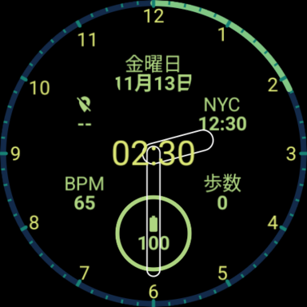

# My Watchface


# 仕組み
DSLを通して[Watch Face Format](https://developer.android.com/training/wearables/wff)形式のXMLを出力する。  
Sassのようなもの。  

記述部分  
https://github.com/matsudamper/WearOS-WatchFaceFormat/blob/main/build-logic/src/main/kotlin/net/matsudamper/WatchFaceFormatGeneratorPlugin.kt  

# セットアップ
Watch Face Format の仕様(XSD)を [google/watchface](https://github.com/google/watchface) の submodule として `third_party/watchface` に取り込んでいる。  
`validateWatchFace` が使うため、ビルド前に取得しておく。  

```shell
git clone --recurse-submodules https://github.com/matsudamper/WearOS-WatchFaceFormat.git
```

clone 済みの場合:
```shell
git submodule update --init --depth 1
```

仕様を更新するとき:
```shell
git -C third_party/watchface fetch origin main
git -C third_party/watchface checkout <コミット>
git add third_party/watchface
```

# インストール方法
## Release
```shell
./gradlew assembleRelease
adb install ./app/build/outputs/apk/release/app-release.apk
adb shell am broadcast -a com.google.android.wearable.app.DEBUG_SURFACE --es operation set-watchface --es watchFaceId net.matsudamper.watchface
```

## Debug
```shell
./gradlew assembleDebug
adb install ./app/build/outputs/apk/debug/app-debug.apk
adb shell am broadcast -a com.google.android.wearable.app.DEBUG_SURFACE --es operation set-watchface --es watchFaceId net.matsudamper.watchface
```
